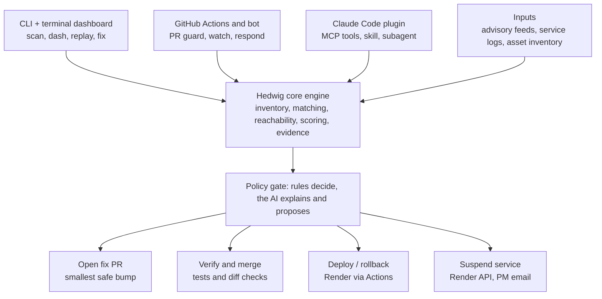

# PS 01 Plan: Hedwig (CLI + GitHub + Claude Plugin)

## 1. What Hedwig is

Hedwig is a developer-native cyber threat early warning system. It reads threat intelligence, works out which threats matter to *your* specific services, and responds at 2am inside limits your team has approved. Its owl mascot watches over your services and only wakes you when something matters.

> Dependabot tells you a dependency is vulnerable. Hedwig decides what your bank should do about it at 2am, and does it safely.

There is no web dashboard. Hedwig lives where developers already work, through three surfaces on one engine:

- **CLI with an interactive terminal dashboard** for scanning, status and replaying incidents.
- **GitHub tool** (Actions plus a bot) that guards pull requests, watches for new advisories, opens fix PRs, deploys or suspends services, and reports to the project manager.
- **Claude Code plugin** so developers can scan, explain and fix from inside Claude.

**Mascot.** An original owl with three states used in the CLI, PR comments and PDF reports: *watching* (all clear), *alert* (a threat needs attention) and *asleep* (a service is suspended).

```
  {o,o}    HEDWIG
  |)__)    threat early warning
  -"-"-
```

How it maps to PS 01:

| PS deliverable | Where it shows |
|---|---|
| Functional prototype | The full flow: scan, score, PR guard, auto-fix, takedown |
| Dashboard of threats, risk levels, alerts | Terminal dashboard, PR comments, Actions summary, PDF report |
| Demo on public or simulated data | Real open-source repos plus a replayed advisory and simulated logs |
| Explanation of AI model, scoring, mitigation | Reasoning line on every alert, scoring formula and policy file (sections 8 and 9) |

## 2. Architecture



Every surface calls the same engine and gets the same answer. Nothing acts without passing the policy gate, which is deterministic and reads per-service permissions from `.hedwig.yml`.

**Monorepo layout.** `core/` (engine), `cli/` (Typer and Textual app), `github/` (workflows and bot), `plugin/` (Claude Code plugin and MCP server), `bank/` (four services and the tablet page), `fixtures/` (cached advisories and expected results).

## 3. Demo bank

One small bank with four services, each in a different language and criticality tier, so each shows a different policy outcome. Judges can use it on a tablet.

| Service | Tier | Language | Seeded weakness (verify on osv.dev) | Demo role |
|---|---|---|---|---|
| Transaction | Critical | Java (Spring Boot) | `log4j-core` 2.14.1, Log4Shell (CVE-2021-44228), fix 2.17.1 | Auto-patch with a minimal bump, verified, auto-merged |
| Account data (read-only) | High | Rust (Axum) | `regex` 1.5.4 (CVE-2022-24713), fix 1.5.5 | Fix PR opened, human approves |
| Customer support | Medium | PHP | `phpmailer/phpmailer`, an older release | PR-time block, then the merged-anyway report path |
| Notifications and promotions | Low | Node.js (Express) | `lodash` 4.17.15 and `jsonwebtoken` 8.5.1 (fix needs major 9.0.0) | No safe minor patch, so autonomous takedown |

A Python service with `PyYAML` 5.3.1 can be added as a reachability example: dangerous only if `yaml.load()` is called, not `safe_load()`.

**Tablet.** A one-page bank site with a tile per service (balance, send money, help, offers). After the transaction fix a judge can send money with no downtime; when notifications is suspended, only the offers tile greys out. An optional "try to attack it" box lets a judge paste a Log4Shell-style string and watch Hedwig react.

**Reproducible.** Pinned lockfiles, a tiny test suite and health endpoint per service, and one command to reset the demo.

## 4. Existing open-source repos for CLI testing

Running Hedwig on repos we did not write shows it discovers problems and was not rigged for the demo. The asset inventory is built from their lockfiles, so it is real.

| Repo | Language | Use |
|---|---|---|
| DVWA | PHP | Detection and prioritisation |
| OWASP WebGoat | Java | Same, plus transitive Java dependencies |
| OWASP NodeGoat | Node | Same, plus import-level reachability |
| An older Rust project at a pinned commit | Rust | A `Cargo.lock` with a known RustSec advisory |

- Use our own forks, and confirm each still has old dependencies.
- Use these for detection and scoring ("87 raw findings, 3 that matter"); auto-fix runs on the bank services, which we control.
- Show Dependabot-style raw output next to Hedwig output on the same repo.
- Keep an expected-results file per repo so we can report precision.

## 5. Hedwig CLI and terminal dashboard

The CLI is the front door and the dashboard: a full-screen, keyboard-driven terminal app with the owl in the header.

| Command | What it does |
|---|---|
| `hedwig scan <path or git-url>` | Builds the inventory from lockfiles, matches advisories, scores, prints a ranked list with reasons |
| `hedwig dash` | Opens the interactive dashboard |
| `hedwig status` | One-shot summary of services, risk and alerts |
| `hedwig explain <finding>` | Plain-language reasoning, evidence level and recommended action |
| `hedwig fix <service>` | Opens the minimal-patch PR and runs verification |
| `hedwig replay <advisory>` | Demo mode: injects an advisory into the real pipeline instantly |
| `hedwig simulate-attack <service>` | Writes an attack-pattern request into that service's log |
| `hedwig report <service>` | Builds the PDF report |
| `hedwig init` | Creates `.hedwig.yml` for a repo |

Every command has `--json`, which the GitHub tool and the Claude plugin reuse.

**Dashboard (`hedwig dash`)**

- Header with the owl, estate-wide risk gauge, feed freshness and a live clock.
- A card per service with tier, health (up, patched, suspended) and risk colour, updating live when Hedwig acts.
- Alert feed, newest first, with severity, evidence level (0 to 4) and a one-line reason.
- Detail pane with the score breakdown, reachability verdict, fixed version and recommended action.
- Action timeline with a time-to-action counter (advisory received to fixed).
- Keys: `Enter` drill down, `f` fix, `t` takedown (dry-run first), `a` approve, `r` replay, `/` filter, `?` help. Mouse support, sparklines, and a diff view of the proposed version bump.

Built with Textual and Rich. Keep a screen recording as a fallback for demo day.

## 6. GitHub tool

The GitHub tool runs the same engine in GitHub Actions with a bot identity (a GitHub App, or a fine-scoped token). No server to host.

| Workflow | Trigger | What it does |
|---|---|---|
| `pr-guard` | `pull_request` | Scans changed lockfiles, comments with risk, reason and safe version, and fails a required check to warn maintainers not to merge |
| `watch` | `schedule`, `repository_dispatch`, `workflow_dispatch` | Pulls new advisories, matches them to each service's stored inventory, scores, and calls `respond` when policy says so |
| `respond` | called by `watch` | Opens the minimal fix PR, runs verification, then merges and deploys, escalates, or suspends |
| `report` | PR merged with a failed or overridden check, and after any autonomous action | Builds the PDF report and emails the project manager |
| `deploy` and `rollback` | called by `respond` | Deploys to Render and rolls back if the post-deploy smoke test fails |

- Branch protection with `pr-guard` as a required check (admin override stays possible, which is how the merged-anyway demo works).
- `.hedwig.yml` per repo holds each service's tier, language, Render service ID, health URL and allowed autonomous actions.
- Secrets in Actions secrets: Render API key, deploy hooks, email key, LLM key.
- Every autonomous action, and every override of a failed check, is written to an audit log and summarised on the related PR.
- The PM report (PDF) covers what was found, why it ranks where it does, evidence seen, the action taken, time-to-action and next steps. It is built from an HTML template with WeasyPrint.

## 7. Claude plugin

A Claude Code plugin that exposes the same engine inside the developer's coding session.

| Component | Purpose |
|---|---|
| MCP server (wraps the CLI's `--json` output) | Tools: `scan`, `status`, `explain`, `propose_fix`, `replay` |
| Slash commands | `/hedwig:scan`, `/hedwig:status`, `/hedwig:fix <service>` |
| Skill | Teaches Claude how to read a Hedwig finding, the evidence ladder and the policy file, and how to explain risk |
| Subagent (`remediator`) | Reads call sites, picks the smallest safe version, edits the manifest, runs tests, returns a diff for approval |
| Hook | Warns when a developer adds a dependency version with a known critical advisory to a manifest file |

The CLI and GitHub tool handle the autonomous 2am path; the plugin handles the human path, with the same scoring and guardrails. Advisory text is treated as untrusted data and never as instructions.

## 8. How Hedwig decides

**Sources.** OSV.dev (affected and fixed versions across npm, PyPI, Maven, crates.io, Packagist), GitHub Advisory Database, NVD (CVSS), CISA KEV (known exploited) and EPSS (exploitation probability), all cached locally. Production polls on a schedule; the demo injects an advisory directly.

**Reachability.** Listed is not used. Hedwig maps imports to packages (Python `ast`, tree-sitter for other languages) and, where an advisory names the affected function, checks for calls to it. This only reorders findings and never hides one.

**Risk score.**

```
risk = exploitability x impact x asset criticality x evidence confidence
```

| Factor | Meaning | Source |
|---|---|---|
| Exploitability | How easy, and is it exploited | CVSS vector, KEV, EPSS, public PoC |
| Impact | How bad if exploited | CVSS impact, the service's data and money exposure |
| Asset criticality | How much we care | Tier in `.hedwig.yml` |
| Evidence confidence | How sure it applies to us | Version present, reachable, attack seen in logs |

Every alert prints its reasoning, for example: "Critical because: actively exploited (KEV), remote code execution, transaction is Tier 0, vulnerable call is reachable."

**Evidence ladder.** Takedown depends on evidence of exploitation, not on a vulnerable version alone.

| Level | Meaning | Example |
|---|---|---|
| 0 | Vulnerable version present | Log4j 2.14.1 in transaction |
| 1 | Reachable, public exploit exists | Vulnerable call on the request path |
| 2 | Exploited in the wild | Listed in CISA KEV |
| 3 | Attack attempts seen against our service | `${jndi:` pattern in access logs |
| 4 | Signs of successful compromise | Unexpected outbound connection or process |

Levels 3 and 4 come from small deterministic detection rules over service logs and events. The AI may draft a rule from the advisory, but matching is plain code. An attempt is not a compromise, which is why the two are separate levels.

**Policy (per service, in `.hedwig.yml`).**

```yaml
services:
  transaction:
    tier: critical
    render_service_id: srv-xxxx
    allow: [open_fix_pr, auto_merge_if_verified, rollback]
    takedown: only_if_evidence_level_gte_4
  notifications:
    tier: low
    render_service_id: srv-yyyy
    allow: [open_fix_pr, auto_merge_if_verified, takedown]
    takedown: if_exploited_and_no_safe_patch
```

Decision order: patch, then mitigate or isolate, then take down. The policy engine is deterministic; the AI explains and proposes within what policy allows.

## 9. Autonomous response: fix, verify, deploy, suspend

**Minimal-change rule.** Pick the smallest version that satisfies the advisory's fixed range, inside the same major version, changing the lockfile only where possible. A fix that needs a major bump (the `jsonwebtoken` case) is never auto-merged.

**Black-box verification before merge.** A patch merges only if it passes every step it can reach:

1. **Targeted existing tests.** Reachability already knows which files use the affected package; run the existing tests that touch those files first, then the full suite.
2. **Differential test.** Record requests and responses from the old build (from tests, an OpenAPI spec or sampled logs), replay them against the patched build and diff status codes, schemas and key fields.
3. **Characterization tests.** For uncovered code, the AI drafts tests that capture current behaviour; they must pass on the old version before they are trusted, then run on the new one.
4. **Dependency re-scan.** Re-check advisories on the new lockfile to confirm no new critical finding.
5. **Post-deploy smoke test.** Hit the health endpoint and key routes; failure triggers automatic rollback.

If any step fails, nothing merges. Hedwig falls back to notifying, then isolating or suspending only if policy allows.

**Deploy and takedown on Render, from GitHub Actions.**

| Action | How |
|---|---|
| Deploy fix | Merge triggers Render, or the `deploy` job calls the Render deploy hook or API |
| Take down | The `respond` job calls the Render API to suspend the service (confirm the exact endpoint in current Render docs) and logs it |
| Resume | A human or a policy rule re-enables the service after a verified patch |
| Roll back | The `rollback` job redeploys the previous successful deploy |

Run each service as a Docker web service with a health check path, on an always-on instance size so the demo has no cold starts. Keep the Render API key in Actions secrets.

**Autonomy levels per service:** observe only, open PRs, auto-merge verified fixes, takedown. Dry-run mode prints the decision without acting. A critical service is only taken down at evidence level 4, or when no patch path exists and policy explicitly allows it.

## 10. Tech stack

| Layer | Choice |
|---|---|
| Engine language | Python 3.12 with `uv`; installs as a `hedwig` command |
| CLI | Typer, with `--json` output |
| Terminal dashboard | Textual and Rich |
| Inventory and matching | `osv-scanner` (wrapped), Syft or cdxgen optional |
| Advisory data | OSV.dev, GitHub Advisory DB, NVD, CISA KEV, EPSS, cached in SQLite |
| Reachability | Python `ast` and tree-sitter |
| Scoring and policy | Plain Python, Pydantic, YAML policy |
| LLM | Claude API with structured JSON output, for explanations, PR text, report text and test drafting; never the final takedown decision |
| GitHub | Actions, PyGithub or `gh`, optionally a GitHub App |
| Reports and email | Jinja2 to HTML to WeasyPrint PDF; SMTP or an email API |
| Deploy | Render API and deploy hooks from Actions, Docker web services |
| Claude plugin | Claude Code plugin with a Python MCP server |
| Bank services | Spring Boot, Axum, plain PHP or Slim, Express; one static tablet page behind a gateway |
| Quality | pytest, ruff, CI in Actions, `make demo` to reset everything |

## 11. Demo flow (about 6 minutes)

Trigger the incident on demand with `hedwig replay` or a `workflow_dispatch` call. In production Hedwig polls feeds; the demo injects the advisory and everything after that is the real pipeline.

1. **Scan a real repo.** `hedwig scan` on a forked open-source repo, next to a raw Dependabot-style list: "87 findings, 3 matter, here is why."
2. **Tablet first.** A judge checks a balance and sends money on the bank site.
3. **Vulnerable PR merged anyway.** A PR on the support service adds a vulnerable dependency. Hedwig comments with the risk and the safe version, and the required check fails. The maintainer ignores the comment and merges anyway with an admin override. The merge triggers the report workflow: Hedwig logs the override, builds the PDF report (what was merged, why it is risky, the safe version, who merged it) and emails it to the project manager. The service stays flagged as carrying known risk, with a raised priority on the dashboard, until it is fixed. - mail the pdf report created using latex to the project manager email provided for now hardcode product manager as "yash1812ys@gmail.com" 
4. **The 2am incident.** `hedwig replay log4shell`: match to the transaction service, KEV and EPSS enrichment, reachability, score and reasoning. Policy says patch, not takedown. Hedwig opens the minimal fix PR, verifies, merges and deploys to Render, and the time-to-action counter stops. The judge sends money again with no downtime.
5. **Attack evidence and takedown.** `hedwig simulate-attack notifications` raises the evidence level. A second advisory with no safe patch (the `jsonwebtoken` case) hits notifications; policy allows it, so the Action suspends the service on Render and only the offers tile greys out.
6. **Close.** `hedwig dash` shows transaction patched, notifications suspended, nothing waiting on a human.

Fallbacks: cached feeds, a local docker-compose copy of the bank, screen recordings of steps 3 to 5, and a private hotspot for the tablet.

## 12. Build order

1. Core engine: lockfile inventory, advisory matching, SQLite store, scoring with reasons, `hedwig scan` and `status`.
2. Bank services with health endpoints, tests, seeded vulnerabilities, docker-compose and `.hedwig.yml`.
3. GitHub `pr-guard`, PR comment, required check, merged-anyway report workflow, PDF report and email.
4. `hedwig replay`, the `watch` workflow, the policy engine and the minimal fix PR with verification.
5. Render deploy, suspend and rollback from Actions, plus the audit log.
6. Terminal dashboard with the owl, services grid, alert feed and time-to-action counter.
7. Log detection rules, attack simulator, import-level reachability and the evidence ladder.
8. Claude plugin: MCP server, slash commands, skill, `remediator` subagent and hook.
9. Differential and characterization tests, tablet page polish, symbol-level reachability.

## 13. Guardrails

- **Public demo services.** Seeded versions must be detectable but not exploitable: use fake data only, never pass user input through the vulnerable path, and take the services down after the event.
- **Autonomy is opt-in and logged.** Deterministic policy gate, per-service permissions, dry-run, automatic rollback and an audit log.
- **Untrusted advisory text.** Treated as data; the LLM returns structured output and cannot change policy or permissions.
- **Demo-day failures.** Cached feeds, replay mode, a local copy of the bank and screen recordings.
- **Verify the facts.** Check every vulnerable and fixed version on osv.dev, and the Render endpoints in current Render docs, before building on them.